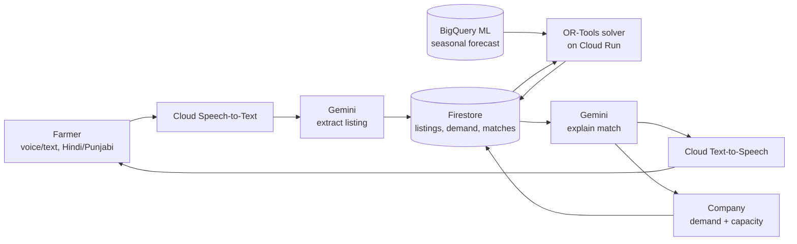

# Parali Setu — Product Requirements Document

**Status:** Draft v2, 2026-10-13 — revised after a first judge-eval scored v1 at 63/100. Changes in v2: locked the forecast-model decision instead of leaving it open (§12, §13.1), added a named competitive-defensibility argument (§7.1), added a risk-mitigation section with a scripted demo fallback (§13.1, §16), expanded the company dashboard spec (§8.2), and added quantified impact context plus a path beyond simulation (§5). Parallel exploration branch (`parali-setu`) — does **not** replace the AidAtlas (Crisis Resource Allocator) submission on `master`. The team will decide between them after this revision is judge-evaluated again.

**Rule for implementation:** this PRD is the governing spec. No code is written against it until the user explicitly says to start. Any deviation during build must be flagged and confirmed, not silently substituted.

---

## 1. Problem statement (official track text, verbatim)

**Track:** Sustainability & Social Impact

> Build an AI-powered solution that addresses a meaningful environmental or societal challenge. Solutions may focus on improving resource efficiency, increasing accessibility, strengthening resilience, supporting communities, or enabling more informed and sustainable decision-making.

**Suggested solution directions:** Climate and environmental intelligence, disaster preparedness, sustainable agriculture, resource optimization, accessibility, community services, waste reduction.

**Suggested Google Cloud technologies:** Gemini on Vertex AI for reasoning and natural-language interfaces, BigQuery for analysing large environmental or social datasets, Vertex AI for predictive models, Earth Engine for geospatial/environmental analysis where applicable, Cloud Storage for datasets and imagery, Vision AI or image analysis capabilities, Cloud Run for deploying applications, Pub/Sub for event-driven alerts or workflows.

## 2. Judging rubric (identical weights across all 6 tracks)

| Criterion | Weight |
|---|---|
| Technical Merit & Gen AI Implementation | 40% |
| Problem Alignment & Impact | 25% |
| Innovation & Creativity | 25% |
| User Experience & Solution Design | 10% |

## 3. Mandatory eligibility constraints

- Must use a Google AI model family (Gemini or Gemma) or be built on an agentic platform (Agent Platform / Antigravity / AI Studio).
- Must be deployed on Google Cloud via Cloud Run or Firebase. Non-Google cloud stacks are not eligible.
- Written submission must explicitly name **Firebase, Firestore, Cloud Run, and Gemini** — not just "Google AI + cloud" in the abstract.
- All materials (code, docs, presentation) in English.

## 4. One-liner

Parali Setu is a live matching system that connects farmers holding crop stubble with companies that turn it into packaging, cutlery, biofuel pellets, and road material — making selling the stubble faster and more certain than burning it, inside the farmer's narrow post-harvest window.

## 5. Theory of change — why this isn't just an advisory chatbot

Farmers in Punjab/Haryana have roughly 10–15 days between harvesting rice and sowing the next crop. Burning is free and takes a day; every alternative costs money or time they don't have. Giving a farmer advice doesn't stop a fire — only a buyer who shows up faster and more reliably than burning, inside that same window, does. The product's core job is therefore **matching speed and certainty**, not information delivery. The AI layer (Gemini) is the interface to that matching system, not a substitute for it.

**Scale, for context (verify precise figures before the public pitch):** Punjab alone is commonly estimated to generate on the order of 15–20 million tonnes of paddy straw each season, and government/SAFAR-India air-quality assessments have attributed a significant share of Delhi-NCR's peak-season PM2.5 spike in October–November to stubble burning in neighboring states. These are widely cited approximate figures, not independently verified for this PRD — treat them as directional until checked against a current CPCB/SAFAR/ICAR report before they appear in the pitch deck.

**Path beyond simulation:** the MVP's matching and transaction records (§10) are modeled so a real counterpart — one willing residue-aggregator or packaging company — could be plugged in post-hackathon without a schema change, turning the simulated `pending_pickup`/`completed` status flow into a real one. This isn't built for the hackathon, but the data model doesn't block it either.

## 6. Users & personas

- **Farmer** — Punjab/Haryana, post-harvest, speaks Hindi or Punjabi, variable literacy, uses a shared/basic smartphone. Needs voice-first interaction and a fast, trustworthy answer: who buys, at what price, when do they come.
- **Company buyer** — procurement/ops staff at a residue-offtake business (pellet plant, stubble-based packaging unit, biofuel producer). Needs to know what supply is coming, what to offer for it, and what to manufacture/where to sell for the season.
- **Out of scope for MVP (roadmap only):** government/NGO monitoring dashboards, logistics/trucking providers as a distinct user type.

## 7. Scope decisions — resolving the gaps already raised

| Gap raised | Resolution |
|---|---|
| Idea bundled three separate products (advisory, marketplace, company consulting) | Ship **one** integrated flow — listing → match → company recommendation — not three disjoint tools. |
| Full agronomy advice (which crop/fertilizer to plant) carries real-world liability and needs data we don't have | **Out of MVP scope.** Advice is limited to stubble disposal logistics and price — never crop/fertilizer recommendations. |
| "Isn't this just another offtake marketplace that already exists?" | Differentiator is the **live AI-mediated bilingual matching + deterministic pricing**, not the marketplace concept itself — argued explicitly in §7.1, not just asserted. |
| Live vs. batch matching | **Live** — the solver re-runs on every new listing or demand update, not on a schedule. |
| Dataset availability | Hybrid: synthetic farmer/company records, calibrated against real public reference data (district residue estimates, Agmarknet prices), clearly labeled as synthetic in the demo. |
| Voice input scope (decided 2026-10-13) | **In scope for MVP**, not a stretch goal — Speech-to-Text/Text-to-Speech is a core feature from the start. |
| Transaction/logistics scope (decided 2026-10-13) | **Simulated** confirm-pickup / confirm-payment step is in MVP. No real money or trucking integration — status fields only, clearly labeled in UI and pitch as simulated. |
| Project status (decided 2026-10-13) | Parallel branch (`parali-setu`); `master`/AidAtlas untouched; decision deferred until after judge-eval and team review. |

### 7.1 Competitive landscape & defensibility (locked 2026-10-13)

Three existing approaches already touch this problem, and each has a specific gap this product closes:

1. **Government Crop Residue Management (CRM) subsidy schemes** — subsidize machinery (balers, super seeders) but don't guarantee a farmer a time-bound buyer; application-based, not language-accessible, and silent on where the residue actually goes afterward.
2. **Offline residue aggregators / depots** — a company sets up a local collection point, but discovery and pricing happen manually, farmer-to-depot, with no live competition between buyers and no structured intake for a non-literate, Hindi/Punjabi-only farmer.
3. **Generic agri-advisory chatbots** — give static advice (what to plant, how to treat a pest) with no transactional engine behind them; nothing to match against, nothing that pays the farmer.

None of the three does **live, multi-buyer, price-discovering matching with a bilingual voice front end**. The defensibility argument isn't "we have an AI chatbot" — competitors can add one too. It's a liquidity argument: once farmers list through the matching layer, companies see faster-matched, more predictable volume than sourcing offline depot-by-depot; more companies listening in turn means better prices for farmers; that flywheel, not any single feature, is what's hard to copy quickly.

## 8. Core user flows

### 8.1 Farmer flow
1. Farmer opens the app, picks Hindi or Punjabi, speaks or types a stubble listing.
2. If spoken: Cloud Speech-to-Text transcribes it; Gemini extracts a structured record — `{quantity, unit, village/district, crop type, ready_by date, contact}` — and shows it back for a one-tap confirm/edit (guards against transcription errors).
3. Listing is written to Firestore.
4. The solver (OR-Tools on Cloud Run) re-runs matching against all open company demand the moment the listing lands.
5. Gemini composes the result — buyer, price per quintal, pickup window — as text and Text-to-Speech audio, in the farmer's language.
6. Farmer confirms interest → match status moves to `pending_pickup` (simulated, no real payment moves).
7. Farmer marks `picked_up` to close the loop (simulated).

### 8.2 Company flow
1. Company logs in (Firebase Auth) and sets/updates standing demand: capacity, price ceiling, quality spec, plant location, product lines.
2. Dashboard is organized into four zones:
   - **Incoming Supply** — live-sorted list of listings matched to this company (quantity, price, distance, pickup window).
   - **Recommendation panel** — one forecast-driven card per period: product to prioritize, target region, and the basis for the suggestion, read from the `forecasts` collection (§10, §12).
   - **Active Matches** — a status board (`proposed → confirmed → pending_pickup → completed`) for everything in flight.
   - **Standing Demand** — the editable form from step 1.

   Company-side UI is English, desktop-first (procurement staff assumed to work from a desk, unlike the farmer's mobile/voice-first flow).
3. Company accepts a proposed match → farmer is notified → simulated transaction record created.
4. Company marks `received` to close the loop (simulated).

## 9. System architecture

Everything left of the solver is language (Gemini + STT/TTS). Everything through the solver is arithmetic (OR-Tools + BigQuery ML). They never swap jobs — Gemini never computes a price or quantity; the solver never generates language. The BigQuery ML box runs once, offline, during data seeding — not as a live call during the demo; forecasts are read from Firestore like any other stored record (§12, §13.1).

## 10. Data model (Firestore collections)

| Collection | Key fields |
|---|---|
| `farmers/{farmerId}` | name, phone, preferred_language, village, district |
| `listings/{listingId}` | farmerId, quantity_kg, crop_type, village, district, ready_by, status (`open`/`matched`/`pending_pickup`/`picked_up`), language |
| `companies/{companyId}` | name, location, capacity_kg_per_week, price_ceiling_per_kg, quality_spec, product_lines[] |
| `demand/{demandId}` | companyId, product, quantity_needed_kg, price_offer_per_kg, valid_until |
| `matches/{matchId}` | listingId, demandId, farmerId, companyId, price_agreed_per_kg, quantity_kg, status (`proposed`/`confirmed`/`pending_pickup`/`completed`), created_at |
| `forecasts/{forecastId}` | companyId or region, product, period, predicted_demand, generated_at |

## 11. Datasets

| Dataset | Type | Source & license |
|---|---|---|
| Farmer stubble listings (qty, district, crop, ready-by) | Synthetic | Generated for the demo; volumes shaped to published district residue estimates (below). |
| Company demand (capacity, price, location, product) | Synthetic | Generated for the demo, modeled on known residue-offtake businesses. |
| District crop-residue volume baseline | Real, reference only | Punjab Remote Sensing Centre / ICAR-CRIDA public residue reports — Government of India, public data. Used to calibrate synthetic volumes, not queried live. |
| Mandi price reference | Real, usable live | Agmarknet API, data.gov.in — Open Government Data License (India). Stretch goal: live price sanity-check. |
| Festival demand calendar (for product-mix forecasting) | Synthetic | Generated for the demo, patterned on documented festival shopping seasonality (Navratri, Diwali). |
| District boundaries | Real, reference only | India district GeoJSON, public-domain government survey data, permissively republished. |

## 12. Tech stack

| Component | GCP service | Role |
|---|---|---|
| Farmer & company language interface | Gemini API (Vertex AI) | Extracts structured listings from natural language; explains matches. Never does arithmetic. |
| Voice I/O | Cloud Speech-to-Text, Cloud Text-to-Speech | Converts farmer speech to text and responses back to speech, Hindi/Punjabi. |
| Matching & pricing engine | OR-Tools on Cloud Run | Solves the live farmer-to-company assignment; the only component that touches money/quantity math. |
| Seasonal demand forecast | BigQuery ML (ARIMA_PLUS) — **locked 2026-10-13, no longer an open choice** | Trained once during data seeding (batch, offline); forecast rows are read from Firestore at runtime, not called live during the demo (§13.1). |
| Live data store | Firestore | Listings, demand, matches, simulated transaction status. |
| Backend hosting | Cloud Run | Hosts the API tying Gemini, STT/TTS, the solver, and Firestore together. |
| Frontend | Firebase Hosting | Farmer and company web dashboards. |
| Match alerts | Pub/Sub + Firebase Cloud Messaging | Pushes a notification the moment a match is made. |
| Login | Firebase Authentication | Separate farmer and company accounts. |

## 13. Non-functional requirements & risks

- **Uptime:** prototype must stay functional through the entire evaluation window with no retries allowed if down — deploy Cloud Run with a minimum instance count to avoid cold-start failures during judging.
- **No fabricated numbers:** if a Gemini call fails, show a plain error — never let the model guess a price or quantity. The solver is the single source of truth for all numbers.
- **No real money or logistics:** every "confirm" action is a Firestore status change, explicitly labeled as simulated in both the UI copy and the pitch, to avoid implying real payment/fintech functionality that isn't built.
- **Voice accuracy:** rural/accented Hindi/Punjabi speech may transcribe imperfectly — mitigated by the confirm/edit step after transcription (step 8.1.2) before a listing is submitted.
- **Language coverage:** Hindi + Punjabi for farmers; English for company-side (procurement staff assumed fluent).

### 13.1 Risk mitigation / contingency (internal — not a pitch claim)

- **Forecast component:** the only committed approach is BigQuery ML ARIMA_PLUS, run offline during data seeding (§12) — there is no hedge left inside the architecture itself. If build time doesn't allow training/serving it, the team will not silently substitute a heuristic; per the header rule, the PRD gets updated and §14/§16 claims revised before the pitch is finalized, not after.
- **Voice I/O failure during judging:** the demo script (§16) carries a scripted recovery step. If live transcription misfires, the presenter falls back to the confirm/edit path already built into the farmer flow (§8.1.2) and narrates it as the designed safety net, not an error. A second, pre-recorded clean take of the same voice interaction is held in reserve as the literal fallback if live input fails twice.
- **Live-service surface:** the MVP integrates nine GCP services. Moving the forecast off the live path (above) removes one dependency from the demo's critical path on purpose; Pub/Sub+FCM and the solver stay live because they're the actual proof points for "live matching," the core claim of the pitch.

## 14. Success metrics mapped to judging criteria

- **Technical Merit & Gen AI (40%):** live Gemini + STT/TTS loop, a deterministic OR-Tools solver that re-runs live on every new listing, and a BigQuery ML forecast trained offline and served from Firestore (§12) — every component here is a locked decision, not an open choice.
- **Problem Alignment & Impact (25%):** direct, concrete tie to stubble burning and Delhi air quality (§5); a specific causal lever (speed + certainty beating burning), not a generic climate dashboard, plus a stated path from simulated to real transactions (§5).
- **Innovation & Creativity (25%):** Gemini-as-interface + OR-Tools-as-decision-engine hybrid, not a pure LLM wrapper; dual-sided (farmer + company) product from one matching core; see §7.1 for the specific argument against the three existing approaches in this space, not just an assertion of novelty.
- **UX & Solution Design (10%):** bilingual voice-first farmer experience (§8.1), a four-zone company dashboard (§8.2), one cohesive flow rather than three disjoint tools.

## 15. MVP cut vs. stretch goals

**MVP (what gets demoed):**
- Farmer flow steps 1–7, voice + text, Hindi + Punjabi.
- Company flow steps 1–4, including the simulated confirm-pickup/confirm-payment step.
- Live solver re-run triggered by each new listing.
- One seasonal forecast example surfaced on the company dashboard (e.g., pre-Navratri plate demand in Gujarat).
- Synthetic seed dataset: roughly 15–20 farmer listings, 5 companies.

**Stretch (only if time remains):**
- Live Agmarknet price feed as a real-time sanity-check on offered prices.
- Map view of active matches.
- Multi-turn negotiation (farmer counter-offer).
- Additional regions/languages beyond Punjab/Haryana and Hindi/Punjabi.

## 16. Demo script outline (3–4 minute video)

1. **0:00–0:30** — Problem cold open: stubble burning and Delhi smog, framed concretely.
2. **0:30–1:30** — Farmer flow, live: speak a listing in Punjabi, watch Gemini extract it, watch a match and price appear within seconds. *Scripted fallback (§13.1): if transcription misfires, the presenter narrates the built-in confirm/edit step as the designed safety net — not a visible failure — with a pre-recorded clean take held in reserve.*
3. **1:30–2:30** — Company dashboard: incoming supply, forecast-driven manufacturing/market recommendation, accept a match.
4. **2:30–3:15** — One architecture slide: Gemini/STT/TTS vs. OR-Tools vs. BigQuery ML split.
5. **3:15–3:45** — Impact framing and close.

## 17. Open items for implementation kickoff (not yet decided — raise before coding starts)

- Exact synthetic seed dataset size/composition beyond the MVP cut's rough numbers.

*(The forecast-model choice that was open here in v1 is now locked — see §12 and §13.1. Resolving that hedge was itself a direct fix from the 2026-10-13 judge-eval.)*

## 18. Branching & workflow

- Branch: `parali-setu`, created off `master`. AidAtlas (`aidatlas-api/`, `frontend/`, `data/`) is untouched on this branch and on `master`.
- **No implementation code is written against this PRD until the user explicitly says to start.**
- This PRD is the governing spec for that implementation once it starts; deviations must be flagged and confirmed, not silently substituted.
