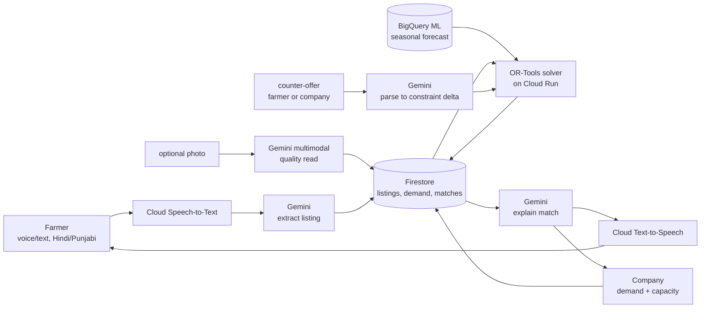

# Parali Setu — Product Requirements Document

**Status:** Draft v4, 2026-10-13 — v3 scored 59/100 again, and the judge's complaints shifted from wording to structure: (1) Gemini only extracted and narrated, which is thin for a 40%-weighted Gen AI criterion; (2) §7.1's "accumulated transaction data" moat has a cold-start problem — it can't exist in the artifact being judged, since the demo only ever holds ~15–20 simulated listings; (3) the forecast corpus fix addressed size, not validity, and §13.1's "fully closed" language was itself an overclaim of the same shape flagged in v2. v4 responds on substance: Gemini's role grows deliberately in two bounded places that don't touch arithmetic — an optional multimodal quality read on a stubble-pile photo (§8.1, §10, §12 — no new GCP service, Gemini is already multimodal) and a multi-turn negotiation loop promoted from stretch to MVP (§8.1, §8.2) — both reuse the existing Gemini+Firestore+solver pipeline rather than adding a subsystem. §7.1 drops the moat claim entirely and argues differentiation on what's actually built today, not a future network effect. §13.1 no longer claims zero risk. A build-sequencing table (§15.1) gives the scope-feasibility question a concrete answer instead of an assertion. Parallel exploration branch (`parali-setu`) — does **not** replace the AidAtlas (Crisis Resource Allocator) submission on `master`.

**Rule for implementation:** this PRD is the governing spec. No code is written against it until the user explicitly says to start. Any deviation during build must be flagged and confirmed, not silently substituted.

---

## 1. Problem statement (official track text, verbatim)

**Track:** Sustainability & Social Impact

> Build an AI-powered solution that addresses a meaningful environmental or societal challenge. Solutions may focus on improving resource efficiency, increasing accessibility, strengthening resilience, supporting communities, or enabling more informed and sustainable decision-making.

**Suggested solution directions:** Climate and environmental intelligence, disaster preparedness, sustainable agriculture, resource optimization, accessibility, community services, waste reduction.

**Suggested Google Cloud technologies:** Gemini on Vertex AI for reasoning and natural-language interfaces, BigQuery for analysing large environmental or social datasets, Vertex AI for predictive models, Earth Engine for geospatial/environmental analysis where applicable, Cloud Storage for datasets and imagery, Vision AI or image analysis capabilities, Cloud Run for deploying applications, Pub/Sub for event-driven alerts or workflows.

## 2. Judging rubric (identical weights across all 6 tracks)

| Criterion | Weight |
|---|---|
| Technical Merit & Gen AI Implementation | 40% |
| Problem Alignment & Impact | 25% |
| Innovation & Creativity | 25% |
| User Experience & Solution Design | 10% |

## 3. Mandatory eligibility constraints

- Must use a Google AI model family (Gemini or Gemma) or be built on an agentic platform (Agent Platform / Antigravity / AI Studio).
- Must be deployed on Google Cloud via Cloud Run or Firebase. Non-Google cloud stacks are not eligible.
- Written submission must explicitly name **Firebase, Firestore, Cloud Run, and Gemini** — not just "Google AI + cloud" in the abstract.
- All materials (code, docs, presentation) in English.

## 4. One-liner

Parali Setu is a live matching system that connects farmers holding crop stubble with companies that turn it into packaging, cutlery, biofuel pellets, and road material — making selling the stubble faster and more certain than burning it, inside the farmer's narrow post-harvest window.

## 5. Theory of change — why this isn't just an advisory chatbot

Farmers in Punjab/Haryana have roughly 10–15 days between harvesting rice and sowing the next crop. Burning is free and takes a day; every alternative costs money or time they don't have. Giving a farmer advice doesn't stop a fire — only a buyer who shows up faster and more reliably than burning, inside that same window, does. The product's core job is therefore **matching speed and certainty**, not information delivery. The AI layer (Gemini) is the interface to that matching system, not a substitute for it.

**Scale, for context:** Punjab's paddy residue volume is commonly reported by state agriculture-department estimates in the 15–20 million tonnes/season range, and CPCB and SAFAR-India monitoring during the October–November burning season has repeatedly linked it to sharp PM2.5 spikes in Delhi-NCR. The mechanism this PRD depends on — a narrow sowing window driving the burn-or-sell decision — doesn't hinge on the exact figure; the precise number is a one-line citation check against the latest CPCB/SAFAR report before the deck ships, not an open question about whether the problem is real.

**Path beyond simulation:** the MVP's matching and transaction records (§10) are modeled so a real counterpart — one willing residue-aggregator or packaging company — could be plugged in post-hackathon without a schema change, turning the simulated `pending_pickup`/`completed` status flow into a real one. This isn't built for the hackathon, but the data model doesn't block it either.

## 6. Users & personas

- **Farmer** — Punjab/Haryana, post-harvest, speaks Hindi or Punjabi, variable literacy, uses a shared/basic smartphone. Needs voice-first interaction and a fast, trustworthy answer: who buys, at what price, when do they come.
- **Company buyer** — procurement/ops staff at a residue-offtake business (pellet plant, stubble-based packaging unit, biofuel producer). Needs to know what supply is coming, what to offer for it, and what to manufacture/where to sell for the season.
- **Out of scope for MVP (roadmap only):** government/NGO monitoring dashboards, logistics/trucking providers as a distinct user type.

## 7. Scope decisions — resolving the gaps already raised

| Gap raised | Resolution |
|---|---|
| Idea bundled three separate products (advisory, marketplace, company consulting) | Ship **one** integrated flow — listing → match → company recommendation — not three disjoint tools. |
| Full agronomy advice (which crop/fertilizer to plant) carries real-world liability and needs data we don't have | **Out of MVP scope.** Advice is limited to stubble disposal logistics and price — never crop/fertilizer recommendations. |
| "Isn't this just another offtake marketplace that already exists?" | Differentiator is **what's actually built today** — live multi-buyer price-discovery, bilingual voice, and a multimodal quality read — not a claimed future network-effect moat. See §7.1. |
| Live vs. batch matching | **Live** — the solver re-runs on every new listing or demand update, not on a schedule. |
| Dataset availability | Hybrid: synthetic farmer/company records, calibrated against real public reference data (district residue estimates, Agmarknet prices), clearly labeled as synthetic in the demo. |
| Voice input scope (decided 2026-10-13) | **In scope for MVP**, not a stretch goal — Speech-to-Text/Text-to-Speech is a core feature from the start. |
| Transaction/logistics scope (decided 2026-10-13) | **Simulated** confirm-pickup / confirm-payment step is in MVP. No real money or trucking integration — status fields only, clearly labeled in UI and pitch as simulated. |
| Project status (decided 2026-10-13) | Parallel branch (`parali-setu`); `master`/AidAtlas untouched; decision deferred until after judge-eval and team review. |

### 7.1 Competitive landscape & differentiation (revised 2026-10-13 — moat claim dropped)

Three existing approaches already touch this problem, and each has a specific gap this product closes:

1. **Government Crop Residue Management (CRM) subsidy schemes** — subsidize machinery (balers, super seeders) but don't guarantee a farmer a time-bound buyer; application-based, not language-accessible, and silent on where the residue actually goes afterward.
2. **Offline residue aggregators / depots** — a company sets up a local collection point, but discovery and pricing happen manually, farmer-to-depot, with no live competition between buyers and no structured intake for a non-literate, Hindi/Punjabi-only farmer.
3. **Generic agri-advisory chatbots** — give static advice (what to plant, how to treat a pest) with no transactional engine behind them; nothing to match against, nothing that pays the farmer.

An earlier version of this section argued a future data-network-effect moat ("accumulated match history gets harder to copy over time"). That claim is dropped: at the point this is judged, no such history exists — the demo runs on simulated listings, so arguing a moat built from real transaction volume would be arguing for something not present in the artifact being evaluated. That's a weaker position than being direct about it.

The honest differentiation claim is narrower and about **today's execution**, not tomorrow's data: none of the three incumbents combines live multi-buyer price discovery, a bilingual voice front end accessible to a non-literate farmer, and a multimodal quality read on the stubble itself (§8.1) feeding directly into the match. Each incumbent is missing a different piece of that combination, not all of it — this isn't a claim that the combination is permanently hard to copy, only that it doesn't exist yet in any of the three alternatives named above.

## 8. Core user flows

### 8.1 Farmer flow
1. Farmer opens the app, picks Hindi or Punjabi, speaks or types a stubble listing.
2. If spoken: Cloud Speech-to-Text transcribes it; Gemini extracts a structured record — `{quantity, unit, village/district, crop type, ready_by date, contact}` — and shows it back for a one-tap confirm/edit (guards against transcription errors).
3. **Optional — photo quality read:** farmer may attach a photo of the stubble pile. Gemini's multimodal input (same Gemini API, no new service — §12) reads it for a rough `quality_grade` (e.g. dry / wet / visibly mixed with other debris) and attaches that to the listing. This is a perception signal the solver consumes as a matching input (§10) — it is never used to set or adjust price itself; a farmer who skips the photo gets a `quality_grade` of `unknown` and the solver falls back to self-reported `crop_type` only. For the recorded demo, this runs against a small set of staged reference photos with a known grade (§11), not an uncontrolled live camera capture.
4. Listing is written to Firestore.
5. The solver (OR-Tools on Cloud Run) re-runs matching against all open company demand the moment the listing lands.
6. Gemini composes the result — buyer, price per quintal, pickup window — as text and Text-to-Speech audio, in the farmer's language.
7. **Optional — negotiation:** the farmer may reply in natural language with a counter-request ("I need at least ₹9.50/kg" or "pickup by Thursday instead"). Gemini parses this into a structured constraint delta and resubmits it to the solver, which returns either an updated match or a clear "not feasible" — Gemini explains whichever outcome comes back. This can repeat; the solver still produces every number, Gemini only ever translates intent into a re-query and explains the result. Logged on the match as `negotiation_log` (§10).
8. Farmer confirms interest → match status moves to `pending_pickup` (simulated, no real payment moves).
9. Farmer marks `picked_up` to close the loop (simulated).

### 8.2 Company flow
1. Company logs in (Firebase Auth) and sets/updates standing demand: capacity, price ceiling, quality spec, plant location, product lines.
2. Dashboard layout (English, desktop-first — procurement staff assumed to work from a desk, unlike the farmer's mobile/voice-first flow):

   ```
   ┌─────────────────────────────┬───────────────────────────┐
   │ INCOMING SUPPLY              │ RECOMMENDATION              │
   │ sorted by price × proximity, │ "Prioritize: disposable     │
   │ descending, updates live via │  plates — target Gujarat"   │
   │ a Firestore listener on      │ basis: pre-Navratri demand  │
   │ listings matched to this     │ forecast (§12), one card    │
   │ companyId                    │ per active period           │
   │ 12 qtl · ₹9/kg · 4km · ...   │                              │
   │ 8 qtl  · ₹8/kg · 11km · ...  │                              │
   ├─────────────────────────────┴───────────────────────────┤
   │ ACTIVE MATCHES (read-only status board, not drag-to-move) │
   │ proposed(2) → confirmed(1) → pending_pickup(3) → completed│
   ├─────────────────────────────────────────────────────────┤
   │ STANDING DEMAND  [capacity] [price ceiling] [quality] ... │
   └─────────────────────────────────────────────────────────┘
   ```

   Status changes (accept, mark received) happen via the Active Matches board; the Incoming Supply and Recommendation panels are read-only views driven by Firestore listeners, not editable here.

   **States not shown in the box diagram above, specified explicitly:** Incoming Supply shows a skeleton row while the initial Firestore snapshot loads, and a plain "No matching supply yet" row (not a blank panel) when there's nothing to show; the Recommendation panel shows "Forecast not yet available" rather than an empty card if a `forecasts` document doesn't exist for the current period; if a Firestore listener errors, the panel shows a retry affordance rather than silently freezing on stale data.
3. Company can also reply to a proposed match in natural language (e.g., "can we get it for ₹8.50 instead") — routed through the same Gemini-parse → solver-resubmit loop as the farmer side (§8.1.7), logged to the same `negotiation_log`.
4. Company accepts a proposed match → farmer is notified → simulated transaction record created.
5. Company marks `received` to close the loop (simulated).

## 9. System architecture



Everything left of the solver is language (Gemini + STT/TTS + the multimodal quality read + negotiation parsing). Everything through the solver is arithmetic (OR-Tools + BigQuery ML). They never swap jobs — Gemini never computes a price or quantity, grades nothing into a price adjustment, and the solver never generates language; the quality read and the negotiation loop both still terminate in the same solver, they're just two more entry points into it. The BigQuery ML box runs once, offline, during data seeding on the dedicated historical series (§11) — not as a live call during the demo; forecasts are read from Firestore like any other stored record (§12, §13.1). Dashboards and the farmer app pick up changes to that Firestore data directly via realtime listeners — this diagram has no separate messaging layer because none is needed (§12).

## 10. Data model (Firestore collections)

| Collection | Key fields |
|---|---|
| `farmers/{farmerId}` | name, phone, preferred_language, village, district |
| `listings/{listingId}` | farmerId, quantity_kg, crop_type, village, district, ready_by, status (`open`/`matched`/`pending_pickup`/`picked_up`), language, quality_grade (`unknown`/`dry`/`wet`/`mixed`, from the optional photo read — §8.1.3) |
| `companies/{companyId}` | name, location, capacity_kg_per_week, price_ceiling_per_kg, quality_spec, product_lines[] |
| `demand/{demandId}` | companyId, product, quantity_needed_kg, price_offer_per_kg, valid_until |
| `matches/{matchId}` | listingId, demandId, farmerId, companyId, price_agreed_per_kg, quantity_kg, status (`proposed`/`confirmed`/`pending_pickup`/`completed`), created_at, negotiation_log[] (each entry: from, request_text, structured_delta, solver_response, timestamp — §8.1.7, §8.2.3) |
| `forecasts/{forecastId}` | companyId or region, product, period, predicted_demand, generated_at |

## 11. Datasets

| Dataset | Type | Source & license |
|---|---|---|
| Farmer stubble listings (qty, district, crop, ready-by) | Synthetic | Generated for the demo; volumes shaped to published district residue estimates (below). |
| Company demand (capacity, price, location, product) | Synthetic | Generated for the demo, modeled on known residue-offtake businesses. |
| District crop-residue volume baseline | Real, reference only | Punjab Remote Sensing Centre / ICAR-CRIDA public residue reports — Government of India, public data. Used to calibrate synthetic volumes, not queried live. |
| Mandi price reference | Real, usable live | Agmarknet API, data.gov.in — Open Government Data License (India). Stretch goal: live price sanity-check. |
| Festival demand calendar (for product-mix forecasting) | Synthetic | Generated for the demo, patterned on documented festival shopping seasonality (Navratri, Diwali). |
| District boundaries | Real, reference only | India district GeoJSON, public-domain government survey data, permissively republished. |
| Historical seasonal demand series (forecast training corpus) | Synthetic | ~2 synthetic years, weekly observations (~104 points) per product/region series, built from the documented festival-seasonality pattern above — distinct from and larger than the small live-demo seed set in §15. Its purpose is to prove the forecasting pipeline and produce a directionally plausible example, not to claim real-world forecast accuracy; it's pattern-based synthetic data, not historical sales records. |
| Staged stubble-pile reference photos (for the Gemini quality read, §8.1.3) | Synthetic/staged | A handful of example photos with a known, pre-assigned quality grade, used in the recorded demo instead of an uncontrolled live photo capture — exercises the real multimodal call while keeping the demo's outcome predictable. |

## 12. Tech stack

| Component | GCP service | Role |
|---|---|---|
| Farmer & company language interface | Gemini API (Vertex AI) | Extracts structured listings from natural language; reads an optional stubble-pile photo for a quality signal (multimodal, same API — §8.1.3); parses negotiation counter-offers into structured deltas (§8.1.7); explains matches. Never does arithmetic — all three new-in-v4 jobs are perception/language, not computation. |
| Voice I/O | Cloud Speech-to-Text, Cloud Text-to-Speech | Converts farmer speech to text and responses back to speech, Hindi/Punjabi. |
| Matching & pricing engine | OR-Tools on Cloud Run | Solves the live farmer-to-company assignment; the only component that touches money/quantity math. |
| Seasonal demand forecast | BigQuery ML (ARIMA_PLUS) | Trained once during data seeding on the ~104-point-per-series synthetic history (§11) — not the small live-demo seed set; forecast rows are read from Firestore at runtime, not called live during the demo. |
| Live data store | Firestore | Listings, demand, matches, simulated transaction status. |
| Backend hosting | Cloud Run | Hosts the API tying Gemini, STT/TTS, the solver, and Firestore together. |
| Frontend | Firebase Hosting | Farmer and company web dashboards. |
| Live updates | Firestore realtime listeners | Dashboards and farmer app subscribe directly to Firestore document changes for "live" supply/match updates — no separate messaging service to deploy. |
| Login | Firebase Authentication | Separate farmer and company accounts. |

## 13. Non-functional requirements & risks

- **Uptime:** prototype must stay functional through the entire evaluation window with no retries allowed if down — deploy Cloud Run with a minimum instance count to avoid cold-start failures during judging.
- **No fabricated numbers:** if a Gemini call fails, show a plain error — never let the model guess a price or quantity. The solver is the single source of truth for all numbers.
- **No real money or logistics:** every "confirm" action is a Firestore status change, explicitly labeled as simulated in both the UI copy and the pitch, to avoid implying real payment/fintech functionality that isn't built.
- **Voice accuracy:** rural/accented Hindi/Punjabi speech may transcribe imperfectly — mitigated by the confirm/edit step after transcription (step 8.1.2) before a listing is submitted.
- **Language coverage:** Hindi + Punjabi for farmers; English for company-side (procurement staff assumed fluent).

### 13.1 Risk mitigation / contingency (internal — not a pitch claim)

- **Forecast component:** fitting ARIMA_PLUS on the ~104-point synthetic series (§11) is a low-risk batch job — minutes, not hours — done during data seeding, well before any demo rehearsal, so it carries no *live* dependency during judging. That doesn't make it zero-risk: seeding the corpus and wiring its output into Firestore is still real integration work for a two-person team. It's sequenced early in the build (§15.1) specifically so a problem surfaces with time to fix it, not during rehearsal.
- **Voice I/O failure during judging:** the demo script (§16) carries a scripted recovery step. If live transcription misfires, the presenter falls back to the confirm/edit path already built into the farmer flow (§8.1.2) and narrates it as the designed safety net, not an error. A second, pre-recorded clean take of the same voice interaction is held in reserve as the literal fallback if live input fails twice.
- **Quality read and negotiation loop add no new live dependency:** both reuse the exact Gemini + Firestore + solver pipeline already built for the primary flow — a second kind of Gemini call and a second kind of solver call, not a second system. If either proves unreliable in testing, each is independently cuttable without touching the core matching loop (§15.1).
- **Live-service surface:** the MVP integrates eight GCP services (down from nine in v1/v2 — §12 dropped Pub/Sub+FCM for Firestore listeners, which the frontend already needs for live updates regardless). Dropping that line item removed a redundant service, not meaningful integration risk — the things that actually have to work for the demo are voice transcription accuracy, solver correctness, and the Firestore listener wiring across both apps, and that list is unchanged by the service count going from nine to eight.

## 14. Success metrics mapped to judging criteria

- **Technical Merit & Gen AI (40%):** Gemini does four distinct jobs — bilingual voice NLU, a multimodal quality read on an image (§8.1.3), negotiation-intent parsing (§8.1.7), and result narration — none of them arithmetic, all of them feeding a deterministic OR-Tools solver that re-runs live on every new listing, plus a BigQuery ML forecast trained on a dedicated ~104-point corpus (§11, §12). This is a wider Gen AI surface than "extract and narrate," while keeping every number traceable to the solver.
- **Problem Alignment & Impact (25%):** direct, concrete tie to stubble burning and Delhi air quality (§5); a specific causal lever (speed + certainty beating burning), not a generic climate dashboard, plus a stated path from simulated to real transactions (§5).
- **Innovation & Creativity (25%):** the combination of live multi-buyer price discovery, bilingual voice, and a multimodal quality signal feeding the match — argued in §7.1 as a gap in what each named incumbent does *today*, not a claimed future data moat.
- **UX & Solution Design (10%):** bilingual voice-first farmer experience with an optional photo and negotiation turn (§8.1), a laid-out company dashboard with defined empty/loading/error states (§8.2), one cohesive flow rather than three disjoint tools.

## 15. MVP cut vs. stretch goals

**MVP (what gets demoed):**
- Farmer flow steps 1–9 (§8.1), voice + text, Hindi + Punjabi — including the optional photo quality read and the negotiation loop, both promoted from stretch in v3 to MVP here.
- Company flow steps 1–5 (§8.2), including the simulated confirm-pickup/confirm-payment step and the defined empty/loading/error states.
- Live solver re-run triggered by each new listing, photo quality read, or negotiation request.
- One seasonal forecast example surfaced on the company dashboard (e.g., pre-Navratri plate demand in Gujarat), generated offline from the ~104-point historical corpus (§11) — not from the small live-demo dataset below.
- Synthetic seed dataset for the *live demo* itself: roughly 15–20 farmer listings, 5 companies. This is separate from the larger historical corpus used only to train the forecast (§11, §12).

**Stretch (only if time remains):**
- Live Agmarknet price feed as a real-time sanity-check on offered prices.
- Map view of active matches.
- Additional regions/languages beyond Punjab/Haryana and Hindi/Punjabi.

### 15.1 Build sequencing & cut order

A concrete answer to "is this buildable by two people," instead of an assertion that it is:

| Phase | Components | Effort | Cut order if time runs short |
|---|---|---|---|
| 1. Core data + solver | Firestore schema, OR-Tools matching logic, both seed datasets (§11) | M | Never — this is the floor of the product. |
| 2. Farmer flow, voice + text | Gemini extraction, Cloud STT/TTS, Firestore write, match display | M | Never — voice is a locked MVP requirement (§7), not a cut candidate. |
| 3. Company dashboard | Four-zone layout, Firestore listeners, empty/loading/error states (§8.2) | M | Recommendation panel can ship with a static example first; Incoming Supply and Active Matches are never cut. |
| 4. Forecast pipeline | BigQuery ML ARIMA_PLUS batch job on the historical corpus (§11, §12) | S, one-time batch | Not cut from the pitch — if the batch job isn't done in time, the dashboard shows one precomputed example card instead of the pipeline's live output. |
| 5. Photo quality read | Gemini multimodal call on staged reference photos (§8.1.3) | S | First cut — listings fall back to `quality_grade: unknown` and self-reported `crop_type`; nothing downstream breaks. |
| 6. Negotiation loop | Counter-offer parsing + solver resubmission (§8.1.7, §8.2.3) | S | Second cut — the flow still works as single-shot matching without it. |

Phases 5 and 6 are the two v4 additions, deliberately placed last and marked independently cuttable — the Gen AI surface they add (§14) is real if they ship, but the core live-matching demo doesn't depend on either.

## 16. Demo script outline (3–4 minute video)

1. **0:00–0:30** — Problem cold open: stubble burning and Delhi smog, framed concretely.
2. **0:30–1:30** — Farmer flow, live: speak a listing in Punjabi, attach a reference stubble photo and show Gemini's quality read, watch a match and price appear within seconds. *Scripted fallback (§13.1): if transcription misfires, the presenter narrates the built-in confirm/edit step as the designed safety net — not a visible failure — with a pre-recorded clean take held in reserve.*
3. **1:30–2:30** — Company dashboard: incoming supply, forecast-driven manufacturing/market recommendation, one quick negotiation turn ("can we get it for ₹8.50"), accept a match.
4. **2:30–3:15** — One architecture slide: Gemini (voice, vision, negotiation, narration) vs. OR-Tools vs. BigQuery ML split.
5. **3:15–3:45** — Impact framing and close.

## 17. Open items for implementation kickoff (not yet decided — raise before coding starts)

- Exact synthetic seed dataset size/composition beyond the MVP cut's rough numbers.
- Exact `quality_grade` categories and the prompt/few-shot examples for the Gemini photo read (§8.1.3) — the three-category sketch above (dry/wet/mixed) is a starting point, not a finalized taxonomy.

*(The forecast-model choice that was open here in v1 is now locked — see §12 and §13.1. Resolving that hedge was itself a direct fix from the 2026-10-13 judge-eval.)*

## 18. Branching & workflow

- Branch: `parali-setu`, created off `master`. AidAtlas (`aidatlas-api/`, `frontend/`, `data/`) is untouched on this branch and on `master`.
- **No implementation code is written against this PRD until the user explicitly says to start.**
- This PRD is the governing spec for that implementation once it starts; deviations must be flagged and confirmed, not silently substituted.
